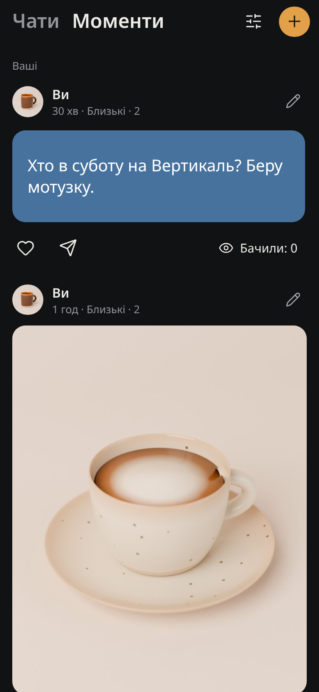
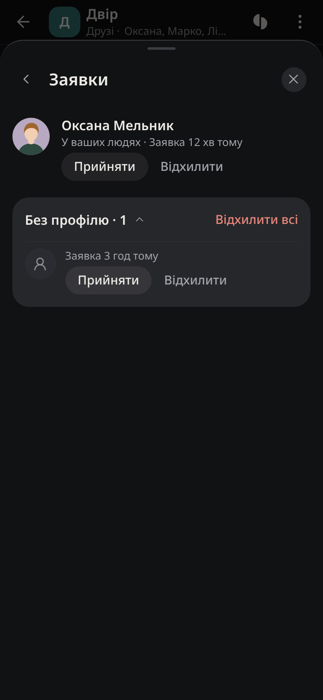
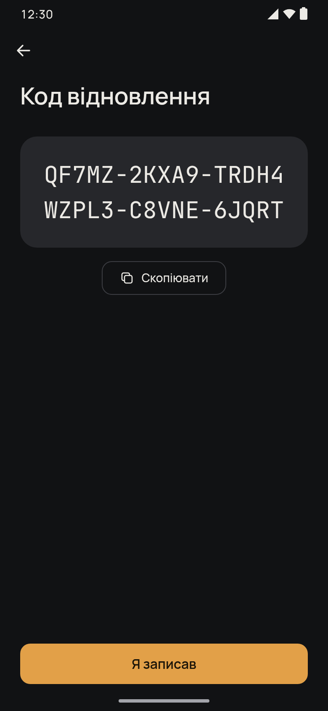
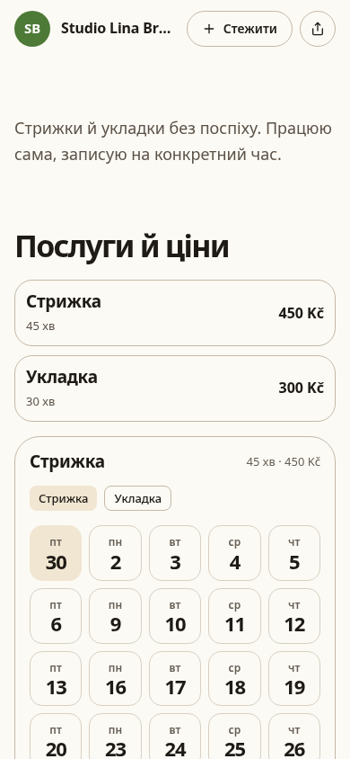
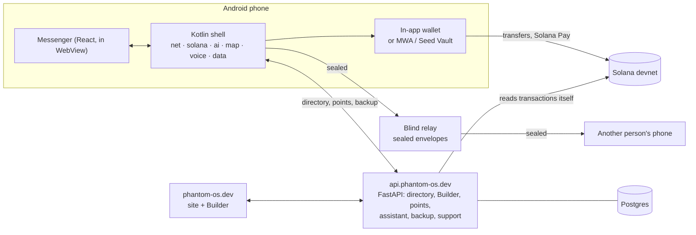

# Nightpost

**Everything a phone is for, joined into one space.** Talk and share, people in circles, the map, your day, money and points, places and organisers, and an assistant that works across all of it.

This repository is the complete product: the Android app, the messenger that ships inside it, the server behind it, the site with its page Builder, and the Solana programs.

| | |
|---|---|
| **App** | Android 10+, Kotlin + Compose shell with a React messenger inside, two flavours (`field`, `store`) |
| **Server** | FastAPI on our own VM at `api.phantom-os.dev`, Postgres |
| **Site** | [phantom-os.dev](https://phantom-os.dev), with the Builder for places, organisers and creators |
| **Money** | Solana devnet: USDC, EURC, SOL. The mainnet switch exists behind an explicit confirmation and is off |
| **Code** | ~1.09 M lines, ~2,800 test files, 26 Android modules |

<table>
<tr>
<td align="center"><br><sub>Moments</sub></td>
<td align="center"><br><sub>Group requests</sub></td>
<td align="center"><br><sub>Account recovery</sub></td>
<td align="center"><br><sub>Builder page</sub></td>
</tr>
</table>

Screens rendered from the app's own code with test data.

## What is inside

| Area | What it does |
|---|---|
| **Conversations** | 1:1 chats, groups, channels and spaces. Join requests, invite links, roles, Saved, drafts, pins, voice notes, files of any size, calls with a call log |
| **People and circles** | Every person appears as a real person: photo, name, handle and mutual people. Circles (close, friends, social, work) decide who sees what |
| **Profiles** | As many profiles as you need, made from templates (personal, work, family, trip, study, business), each with its own handle, inbox, circles and settings. One tap switches between them |
| **Moments** | Photo and text posts with an audience per post, a viewer, reactions and seen counts, plus a strip in your day |
| **Map** | Vector map with its own place index, search, place sheets, routes and transit where open timetables exist. Downloadable country packs |
| **Your day** | Plans, reminders and what the assistant did for you, in one list |
| **Wallet** | Send and request money inside a chat, split a bill by dish, Solana Pay, an in-app wallet or an external one (Mobile Wallet Adapter / Seed Vault) |
| **Points and gifts** | Earned for real activity, spent on gifts. Claims are signed by a separate key |
| **Builder** | Places, organisers and creators build a page from blocks, take bookings and requests, and publish to the site. The same editor runs on the site and in the app |
| **Assistant** | Works across chats, map, day and Builder. The server picks the model for each kind of request, so the app never holds a model name or a key |
| **Backup** | Encrypted snapshot of profile, circles and chats. A new phone restores it |

## How it fits



More in [docs/ARCHITECTURE.md](docs/ARCHITECTURE.md).

## Repository map

| Path | What | Stack |
|---|---|---|
| [`phantom-companion/`](phantom-companion) | Android app: shell, 26 modules (`core-*`, `feature-*`, `app`) | Kotlin, Compose, Gradle 8.11, AGP 8.7 |
| [`phantom-os/src/frontend`](phantom-os/src/frontend) | Messenger UI that ships inside the APK | React 18, Vite 5, TypeScript |
| [`phantom-os/src/backend`](phantom-os/src/backend) | Computer node: the same account on a desktop | Python 3.11, FastAPI |
| [`platform-site/`](platform-site) | Site, Builder editor, and the API server (`server/`) | React + Vite, FastAPI |
| [`solana-programs/`](solana-programs) | On-chain programs | Rust, Anchor (devnet) |

Internal code paths still use the early code name `phantom`; the product is Nightpost.

## How we build it

- **A change ships with its proof.** Every change needs a test that fails without it, and the new code must be reachable from a real entry point on the phone.
- **The messenger bundle is sealed.** The web bundle in the APK is a committed artifact, built from a clean commit and stamped with a content hash. Gradle refuses to package a bundle that does not match its seal.
- **One gate.** `scripts/gate.sh` runs the module tests from fresh JUnit reports. A module with zero tests or a stale report is red even when Gradle reports success.
- **Nothing invented in the UI.** When there is no data, the screen says so honestly. A control either works end to end or has no entry point.
- **Keys never ship.** No provider key, model name or secret goes into the APK. The server holds them, and the repository holds only `*.env.example` files with empty values.

## Build and test

```bash
# Android
cd phantom-companion
bash scripts/gate.sh :app:testFieldDebugUnitTest :app:testStoreDebugUnitTest
bash scripts/gate.sh :app:assembleFieldDebug

# Messenger
cd phantom-os/src/frontend && npm ci && npx vitest run && npm run typecheck

# Site and server
cd platform-site && npm ci && npm run build
cd server && python -m pytest tests -q
```

Full setup, the bundle seal and release steps are in [docs/DEVELOPMENT.md](docs/DEVELOPMENT.md). Security model: [docs/SECURITY.md](docs/SECURITY.md).

## Licence

Proprietary. All rights reserved. See [LICENSE](LICENSE).
