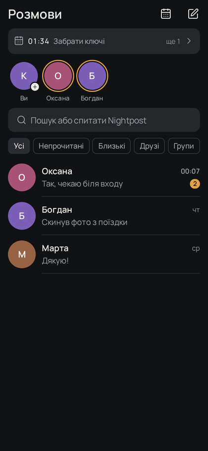
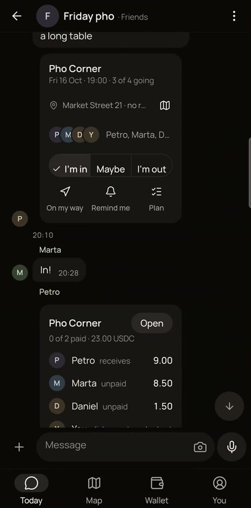
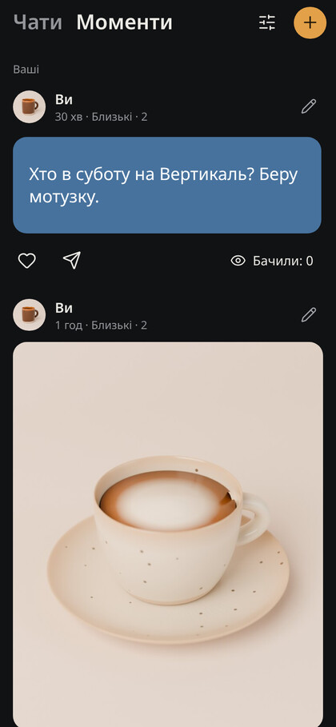
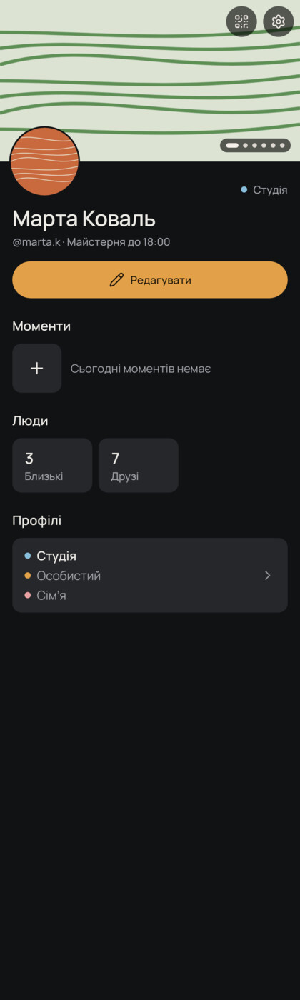
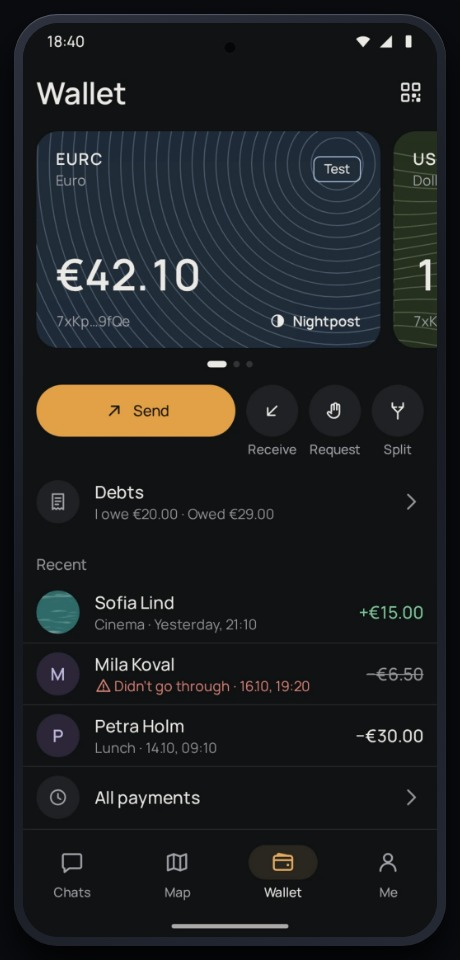
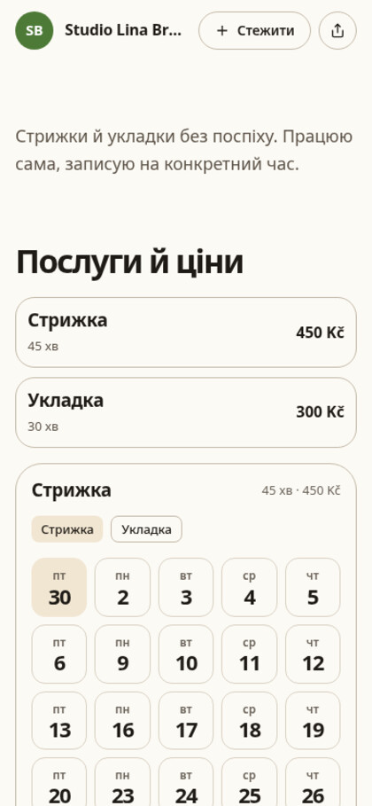
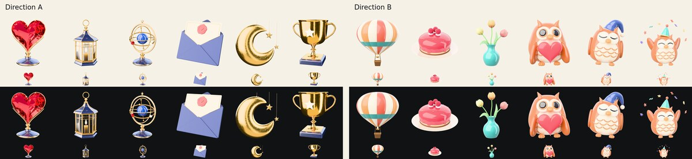
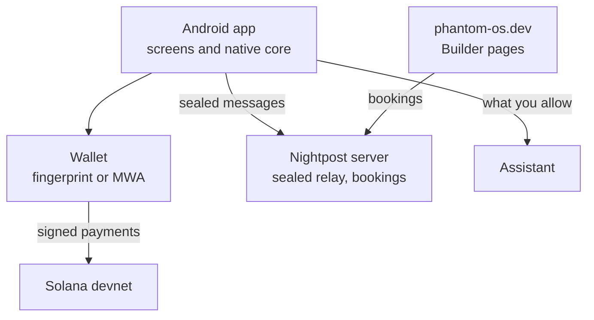

  <picture>
    <source media="(prefers-color-scheme: dark)" srcset="docs/img/mark-dark.svg">
    
  </picture>

<h1 align="center">Nightpost</h1>

  <b>Everything a phone is for, in one space.</b> 
  Talk and share, your people in circles, the map, your day, money and gifts, places and organisers. 
  One assistant works across all of it.

  <a href="https://phantom-os.dev"><b>phantom-os.dev</b></a> &nbsp;·&nbsp;
  <a href="https://phantom-os.dev/download"><b>Download for Android</b></a> &nbsp;·&nbsp;
  <a href="https://github.com/Kiril003/phantom-solana"><b>On Solana</b></a>

  
  
  

<table>
  <tr>
    <td align="center" width="33%"> <b>Chats</b></td>
    <td align="center" width="33%"> <b>Plans</b></td>
    <td align="center" width="33%"> <b>Your day</b></td>
  </tr>
  <tr>
    <td align="center" width="33%"> <b>Circles</b></td>
    <td align="center" width="33%"> <b>Money</b></td>
    <td align="center" width="33%"> <b>Places</b></td>
  </tr>
</table>

Screens from the Android app on a real phone. Names and places are test data.

---

## What it is

A day on a phone is split across a messenger, a map, a calendar, a banking app and a dozen pages for the places you go. Nightpost puts them in one space that knows how they connect: a plan made in a chat lands in your day, a place on the map opens a chat with its owner, and the bill after dinner splits in the same group.

## Talk and share

- Chats, groups, channels and calls. No phone number needed to start.
- A meetup card in a group: place, time, who is going, one tap to answer.
- Moments that only the circles you pick can see.
- Voice and video notes, photos with markup, view-once media.

## People in circles

- Sort people into personal, close, friends, social and work.
- Each circle sees only what you choose: your Moments, your place, your status.
- Keep several profiles, each with its own people and settings, and switch with one tap.
- Meet in person: show your code, scan theirs.

## The map

- Search places, and see people who share where they are with you.
- Routes on foot, by bike, by car and by public transport.
- A place sheet with hours and the way there, one tap from a chat.
- Places made in Builder show up as pins.

## Your day

- Plans, reminders and promises made in chats, in one row above your chats.
- Your phone calendar sits next to plans from groups.
- Debts come back as reminders, with a button to pay.

## Money, points and gifts

- Send USDC, EURC or SOL inside a chat. Request money, or split a bill by person.
- Points for real activity, and 3D gifts to give in a chat or keep on a profile.
- All money runs on Solana devnet with test funds. See [how it uses Solana](#how-it-uses-solana).

## Places and organisers

- **Builder** makes a page for a café, a studio, a club or a class.
- Services, hours, prices and slots are real fields, so the map and the assistant can read them.
- Bookings and questions arrive as chats. Staff get their own access.
- The assistant drafts a page from a description and a price list, and shows what is still missing before anything goes live.

## The assistant

- Works across chats, the map, your day, money and Builder.
- Sums up unread chats, finds a place, drafts a plan or a payment.
- Reads only what you allow and acts only after your tap. A payment always needs your fingerprint.

---

## How it uses Solana

All money runs on **devnet**, with test funds. Mainnet stays off until an independent review.

| What | In plain words | Status |
| --- | --- | --- |
| Wallet | A key in the phone's secure hardware behind your fingerprint, or any wallet app through Mobile Wallet Adapter (MWA) with Sign In With Solana | Works on devnet |
| Pay in a chat | USDC and EURC as SPL tokens, SOL as a plain transfer, each with a memo that ties it to the chat | Works on devnet |
| Pay links and QR | Solana Pay requests that any wallet can open | Works on devnet |
| Signed cash | A payment signed now and sent to the network later. A durable nonce makes any second copy fail. [See one on devnet](https://explorer.solana.com/tx/5u377JHTiKakSqVdN3QB33qeQLUFxNBpx8vRmqAb83yRCHPRARt4XJWvqn9oZT3Pa1XYC5tH3sPrA9MdFBY9i3JT?cluster=devnet) | Works on devnet |
| Seeker | Finds Seed Vault on the device and reads the Seeker Genesis Token | Read-only |
| Escrow for bills and bookings | An on-chain program, explained below | Written and tested, not yet deployed |
| No SOL for fees | Our server can pay the network fee for USDC and EURC transfers | Built, not switched on |

**The escrow program, in plain words.** It has two jobs.

1. **Split a bill.** Each person's share waits in a vault that only the program controls. When the last share arrives, the whole sum goes to the person who paid. If the bill is cancelled or runs out of time, every share goes back to whoever sent it.
2. **Hold a booking deposit.** A guest's deposit waits until the visit. Cancel before the place's cutoff and it comes back. If the place allows it, a no-show's deposit goes to the place.

The rules are written into the program, so no person decides where a share goes.

Devnet addresses the app uses:
[USDC](https://explorer.solana.com/address/4zMMC9srt5Ri5X14GAgXhaHii3GnPAEERYPJgZJDncDU?cluster=devnet) ·
[EURC](https://explorer.solana.com/address/HzwqbKZw8HxMN6bF2yFZNrht3c2iXXzpKcFu7uBEDKtr?cluster=devnet) ·
[Memo](https://explorer.solana.com/address/MemoSq4gqABAXKb96qnH8TysNcWxMyWCqXgDLGmfcHr?cluster=devnet)

---

## How it fits together

- Messages are sealed on the phone. The server carries them without being able to read them.
- Payments are signed on the phone. Keys never leave it.
- The assistant sees only what you allow, and every action waits for your tap.

---

## Get it

- **Android 10 or newer:** [phantom-os.dev/download](https://phantom-os.dev/download)
- **Builder and public pages:** [phantom-os.dev](https://phantom-os.dev)
- Money in the app is devnet test funds. Nothing here touches real money.

## Licence

Proprietary, all rights reserved. See [LICENSE](LICENSE).
